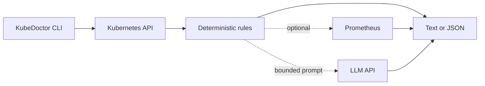

# KubeDoctor

**Kubernetes failure diagnosis from the terminal.**

KubeDoctor reads pod status and events through the Kubernetes API, recognizes a focused set of common failures, and returns the evidence and next `kubectl` command in text or JSON. Prometheus context and LLM explanations are optional; diagnosis works without either.

```text
[CRITICAL] pod/api-7d9d6: Container repeatedly crashes
  Inspect the previous container attempt; its logs usually contain the application error.
  Evidence:
  - container/api: waiting=CrashLoopBackOff, restarts=4
  Fix: kubectl -n demo logs api-7d9d6 -c api --previous
```

## What it diagnoses

| Failure | Evidence used | Suggested command |
| --- | --- | --- |
| `CrashLoopBackOff` | Waiting state and restart count | Previous container logs |
| `OOMKilled` | Current or previous termination reason | Workload resource inspection |
| Image pull failures | Waiting reason and runtime message | Targeted image replacement template |
| Pending pod | `FailedScheduling` events | Capacity, PVC, taint, or scheduling inspection |

KubeDoctor never asks an LLM to classify a failure. Rules produce the diagnosis first; an LLM can only explain that existing result. Commands containing `<working-image>` require an operator choice because the cluster cannot reveal the intended value.

## Install and run

Python 3.11 or newer and access to a Kubernetes cluster are required.

```sh
python -m venv .venv
. .venv/bin/activate
pip install -e .

kubedoctor diagnose -n default
kubedoctor diagnose -A -o json
kubedoctor diagnose -n payments --pod api-7d9d6
```

Exit code `0` means no supported failure was found, `1` means diagnoses were printed, and `2` means configuration or API access failed. The current kubeconfig context is used unless `--context` is supplied.

The container runs as a non-root user:

```sh
docker build -t kubedoctor:local .
docker run --rm kubedoctor:local --version
```

For in-cluster use, apply [the read-only RBAC example](manifests/rbac.yaml). It grants only `get` and `list` on pods and events.

## Optional context

Add a Prometheus memory sample to the evidence:

```sh
kubedoctor diagnose -n demo --prometheus-url http://localhost:9090
```

Add a plain-language explanation with an OpenAI-compatible chat-completions endpoint:

```sh
export KUBEDOCTOR_LLM_URL=https://provider.example/v1/chat/completions
export KUBEDOCTOR_LLM_API_KEY=your-token
export KUBEDOCTOR_LLM_MODEL=your-model
kubedoctor diagnose -n demo --explain
```

Only the diagnosis title, collected evidence, and recommended command are sent. Credentials, Kubernetes objects, and environment variables are excluded. If either optional service fails, KubeDoctor reports that enrichment was skipped and still prints its deterministic result.

## Reproduce every failure

The kind lab creates four intentionally broken workloads in an isolated local cluster:

```sh
make install
make lab-up
make lab-verify
make lab-down
```

`lab-verify` waits until all four diagnosis codes are observed. It calls the live Kubernetes API instead of treating fixture names as proof. See the [demo walkthrough](docs/demo.md) for an interview-friendly flow.

## Architecture



The project stays intentionally narrow: pod-level diagnosis, one cluster per invocation, read-only collection, and four high-value failure families. It does not mutate workloads automatically or pretend that a generic resource value is safe for every application.

## Development

```sh
make check
make image
```

GitHub Actions repeats static checks, unit tests, the image build, and the complete kind lab. Image and action references are pinned, the test cluster is always deleted, and obsolete runs are cancelled.

| Path | Purpose |
| --- | --- |
| [`src/kubedoctor`](src/kubedoctor) | CLI, API collection, rules, rendering, and enrichments |
| [`tests`](tests) | Rule, renderer, enrichment, and manifest tests |
| [`lab`](lab) | Reproducible broken workloads and kind configuration |
| [`scripts/lab.sh`](scripts/lab.sh) | Lab lifecycle and live verification |
| [`manifests/rbac.yaml`](manifests/rbac.yaml) | Least-privilege in-cluster access |
| [`.github/workflows/checks.yml`](.github/workflows/checks.yml) | Complete CI validation |

## Resume wording

> Built a Python CLI that diagnoses CrashLoopBackOff, OOMKilled, image-pull failures, and pending-pod causes from Kubernetes API evidence; added copyable kubectl guidance, optional Prometheus and LLM context, and reproducible kind-based integration tests.

